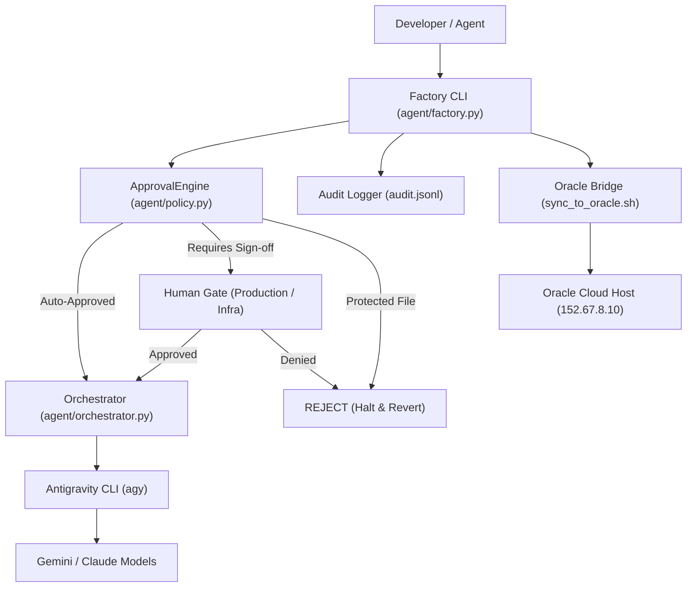

# AI Project Factory & Oracle Antigravity Bridge

An autonomous, policy-governed AI development system built on the Google Antigravity CLI (`agy`) with multi-host execution (Termux & Oracle Cloud).

---

## Architecture Overview



---

## Features

- **Strict Governance Engine (`agent/policy.py`)**:
  - Deterministic file path validation.
  - Hard-coded protected boundaries (e.g., `.env`, core policy files).
  - Human Gate interception for production, deployment, and infrastructure modifications.
- **Autonomous Self-Healing Orchestrator (`agent/orchestrator.py`)**:
  - Automatically captures compile/runtime errors from `agy` executions.
  - Re-prompts the model with error context and stack traces to self-heal.
  - Enforces execution timeouts and clean rollbacks.
- **Append-Only Audit Trail (`audit.jsonl`)**:
  - Records every prompt, step, commit hash, policy decision, and execution status.
- **Oracle Cloud Antigravity Bridge (`sync_to_oracle.sh`)**:
  - Zero-friction synchronization between local environment (Termux/Linux) and remote Oracle Cloud builder instance.
  - Automated diagnostic health checks (`--doctor`), test runners (`--test`), and remote prompt execution (`--agy`).

---

## Quick Start

### 1. Run Factory Diagnostics
```bash
python agent/factory.py --doctor
```

### 2. Execute a Development Task with Factory
```bash
# Execute prompt directly
python agent/factory.py -p "Step 1: Create a utility in sandbox/math_helper.py"

# Or run from task manifest
python agent/factory.py inbox/task_manifest.txt
```

### 3. Run Test Suite
```bash
pytest -q
# 40 passed in 0.35s
```

### 4. Sync & Execute on Oracle Cloud Instance
```bash
# Diagnostic health check on Oracle
./sync_to_oracle.sh --doctor

# Synchronize codebase to Oracle (/home/ubuntu/termux-ai-sandbox)
./sync_to_oracle.sh --sync

# Run remote test suites (Factory + Algo Lab baseline)
./sync_to_oracle.sh --test

# Run an Antigravity prompt directly on Oracle
./sync_to_oracle.sh --agy "Implement a fast prime factorization helper"
```

---

## Project Structure

```
├── agent/
│   ├── brain.py            # High-level task coordination
│   ├── factory.py          # Primary CLI runner & state management
│   ├── orchestrator.py     # Subprocess execution & self-healing loop
│   ├── policy.py           # Governance & ApprovalEngine
│   └── sandbox_proof.py    # Automated policy verification proof
├── tests/                  # Full pytest suite (40 tests)
├── inbox/                  # Incoming task manifest staging
├── sync_to_oracle.sh       # Multi-host sync & remote agy runner
├── FACTORY_OPERATING_PROCEDURE.md # Detailed FOP manual
├── pytest.ini              # Test isolation configuration
└── README.md
```

---

## Governance & Safety Guarantees

All changes are evaluated against the `ApprovalEngine` before application:
1. **AUTO_APPROVE**: Changes confined to allowed paths (`sandbox/`, `tests/`, etc.).
2. **HUMAN_REQUIRED**: Infrastructure or production configs require explicit user confirmation.
3. **REJECT**: Modification attempts on protected paths halt the runner immediately with code `1`.
